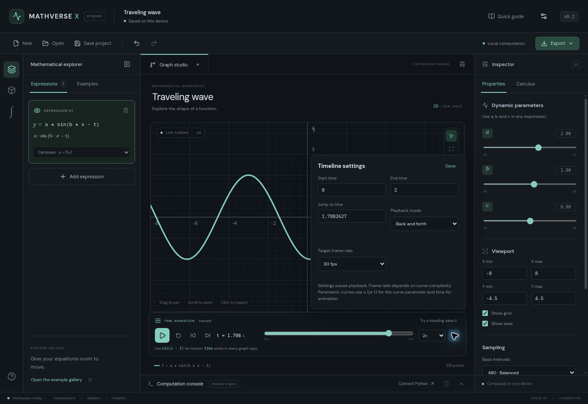

# MATHVERSE X

**Explore mathematics. Understand its shape.**

A local-first mathematical visualization and computational studio, built for incremental development into 2D, 3D, 4D and higher-dimensional mathematics.

**Current release: v0.2.0 — Animated graph studio.** This is a working graphing and calculus application with an optional Python symbolic service. The complete enterprise platform in the brief is not finished; 3D/4D and the remaining labs are defined in the roadmap.

GitHub repository: [ShivamMathtech/mathverse-x](https://github.com/ShivamMathtech/mathverse-x).



## Run locally

Install **Node.js 24 LTS**. Extract the ZIP and open a terminal inside the `mathverse-x` folder (the folder containing this README and the root package.json).

```bash
npm ci
npm run dev
```

Open the URL printed by Vite, normally `http://localhost:5173`.

On Windows, you can instead double-click `scripts/start-frontend.bat`. It installs the locked npm dependencies if missing, then starts the app. Initial package installation needs internet access. Do not copy Linux node_modules to Windows; the ZIP intentionally excludes dependencies.

For animation, open **Traveling wave** in Examples or enter `2 * sin(x - t)`, then press **Play** below the graph. Read the [animation guide](documentation/ANIMATION.md) for controls and examples.

The frontend does not require Python, an API key, a database, or a connected backend. All browser features below perform real calculations.

## What works

| Area | Implemented in v0.2 |
| --- | --- |
| Graphs | Cartesian, polar, parametric and scalar conditional expressions; multiple independently editable/colorable layers |
| Interaction | Pan, wheel/button zoom, reset, equal axis scale, fullscreen, sampled curve tracing, fit sampled curves, major/minor grid, per-curve line width and style |
| Animation | Play/pause, restart, scrubbing, frame stepping, speed, time bounds, loop/once/back-and-forth modes and target frame rate |
| Parameters | Live a/b/c sliders shared by the selected project |
| Calculus | Numerical derivatives, tangent/derivative overlays, adaptive Simpson integrals with estimated errors, bisection roots with residual checks, local symbolic differentiation |
| Console | Scalar evaluation, symbolic differentiation, execution history, visible errors, cancellable worker jobs |
| Projects | Automatic browser recovery; new project; JSON download and reopen; bounded undo/redo; ten editable examples, including four animated examples |
| Export | SVG vector graph, PNG at 2× canvas size, sampled CSV with segment identifiers and time, portable project JSON |
| Appearance | Dark/light themes, adjustable interface font size, responsive panel layout |
| Optional backend | Authenticated SymPy differentiation, integration, simplification, expansion, factorization and real-domain solving |

Try `sin(x)`, `a * sin(b * x) + c`, `x^2`, `sqrt(abs(x))` or `x < 0 ? -x : x^2`. Polar curves use `theta` (with `t` as an alias), and parametric curves use `u` (or legacy `t`). Use `time` for animation in every graph type; Cartesian graphs also accept `t` as time. Trigonometric input is in radians. The Python grammar requires explicit multiplication and supports the smaller function set documented in `documentation/API.md`.

## Deploy the frontend on Vercel

Import `ShivamMathtech/mathverse-x` into Vercel.

| Vercel setting | Value |
| --- | --- |
| Root Directory | Repository root (`.`), not `frontend` |
| Framework Preset | Vite |
| Install Command | `npm ci` |
| Build Command | `npm run build` |
| Output Directory | `frontend/dist` |
| Node.js Version | 24.x |
| Required environment variables | None |

The committed `vercel.json` already declares the build settings, output path and SPA fallback. Keep `package-lock.json` committed. No live Vercel deployment is included in this source package.

For a standalone demonstration, leave `VITE_API_URL` unset. Graphing, numerical calculus, saving and export remain functional. To connect a hosted Python service later, set `VITE_API_URL` to its HTTPS origin in Vercel and redeploy, or enter its URL in the application's Settings. Never put a secret token in a `VITE_` variable; Vite exposes those values in the browser bundle.

See [the complete deployment guide](documentation/DEPLOYMENT.md).

## Optional Python backend

Use **Python 3.12**. On Windows, double-click `scripts/start-backend.bat`; it creates a virtual environment, installs the backend packages, generates a local token if no .env exists, and starts the API at `http://127.0.0.1:8000`.

Manual Windows PowerShell setup from the repository root:

```powershell
py -3.12 -m venv backend/.venv
backend/.venv/Scripts/python.exe -m pip install -r backend/requirements.txt
backend/.venv/Scripts/python.exe scripts/configure_backend.py
cd backend
.venv/Scripts/python.exe -m uvicorn app.main:app --env-file .env --host 127.0.0.1 --port 8000
```

macOS/Linux:

```bash
python3.12 -m venv backend/.venv
backend/.venv/bin/python -m pip install -r backend/requirements.txt
backend/.venv/bin/python scripts/configure_backend.py
cd backend
.venv/bin/python -m uvicorn app.main:app --env-file .env --host 127.0.0.1 --port 8000
```

Open frontend Settings, enter `http://localhost:8000`, and paste the token from your own `backend/.env`. Choose **Connect & test**. Python operations then appear in the console's operation selector. The token stays only in page memory and is not exported in a project.

A frontend served over HTTPS requires an HTTPS backend. Public deployment must use your own private token and exact allowed frontend origins. This v0.1 shared-token service is intended for one owner; it has no multi-user accounts, project sharing or per-user quotas. Do not embed a shared token in a public demo. The standalone demo needs no backend at all.

## Tests and production build

```bash
npm test
npm run build
npm run preview
```

Backend, from the `backend` folder after creating the virtual environment:

```powershell
.venv/Scripts/python.exe -m pip install -r requirements-dev.txt
.venv/Scripts/python.exe -m pytest -q
```

On macOS/Linux use `.venv/bin/python` instead. GitHub Actions includes frontend validation and a backend Windows/Linux matrix. That workflow runs after you push; a local Linux test run does not establish that the Windows job passed.

## Project organization

- `frontend/src/mathematics/`: mathematical contracts, expression validation, numerical methods and sampling.
- `frontend/src/workers/`: cancellable calculation worker and client.
- `frontend/src/graphing/`: renderer and exports.
- `frontend/src/state/`: versioned project validation, examples and undo/redo.
- `frontend/src/components/`: inspector, computation console and controls.
- `backend/app/`: FastAPI routes, strict AST parser and isolated SymPy jobs.
- `backend/tests/`: mathematical/API/security regression cases.
- `scripts/`: Windows startup and backend configuration.
- `documentation/`: architecture, roadmap, deployment, API and validation records.
- `examples/`: portable project files.

## Numerical and release boundaries

The browser uses Float64 arithmetic. Adaptive sampling is heuristic; it does not prove continuity or capture every feature. Extremely oscillatory functions may alias. Numerical integration assumes a smooth finite interval; improper integrals require explicit subdivision and are not supported automatically. Error estimates are method estimates, not certified bounds. Bisection checks the final residual and requires opposite endpoint signs; it does not enumerate roots or generally find even-multiplicity roots. Finite-difference derivatives are not reliable at nonsmooth points.

The project format saves curve definitions, colors, visibility, domains, parameters, sampling, axes, viewport and timeline settings/current time. Playback always reopens paused. Console history, temporary calculus overlays and API credentials are session-only. Browser storage is recovery, not a backup; download the JSON to keep a portable copy. New projects and examples can be undone until the page reloads.

Not implemented yet: implicit curves, 3D surfaces, 4D slicing/projections, general ND algorithms, dataset import, animation keyframes/video export, SQLite project management, collaboration, plugin execution, Tauri or desktop installers. Only implemented graph types and exports are exposed. See [ROADMAP.md](documentation/ROADMAP.md) and [ARCHITECTURE.md](documentation/ARCHITECTURE.md).
